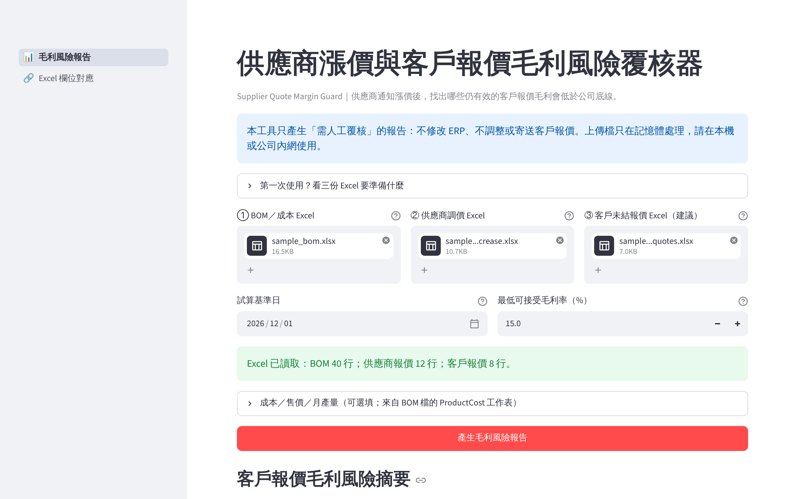
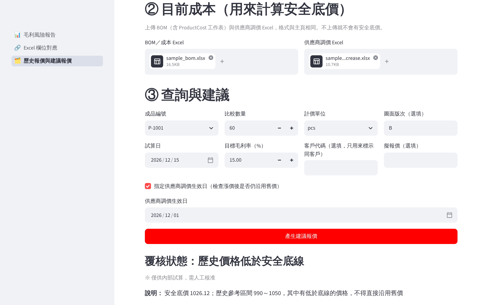
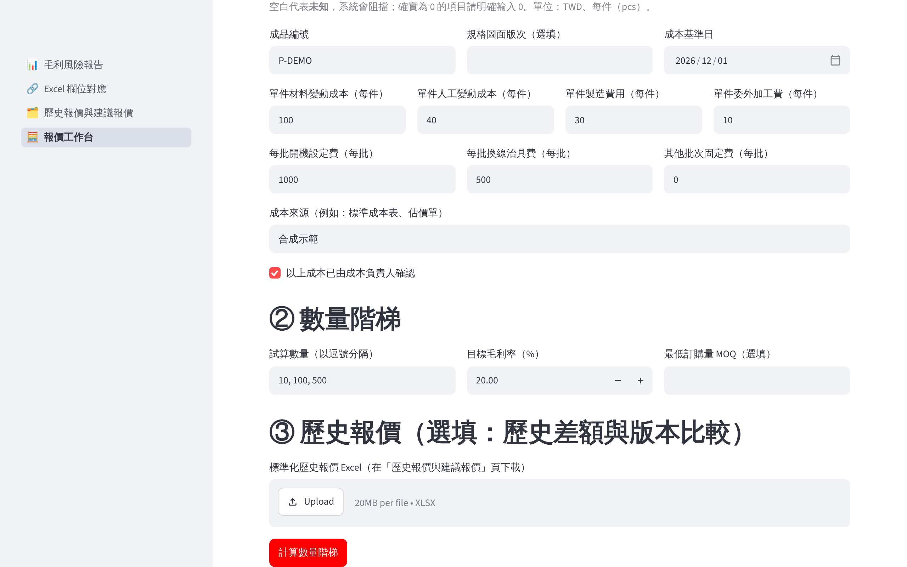
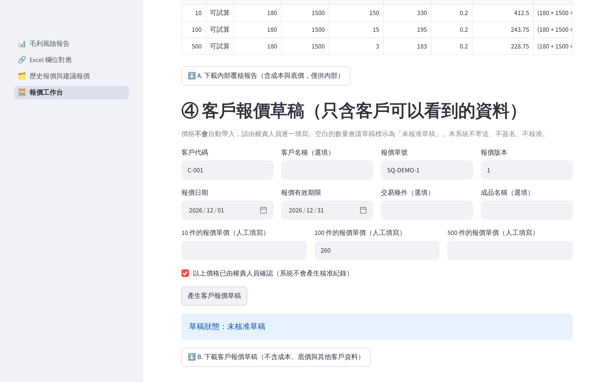

# Supplier Price Impact

**企業成本與報價決策系統**

Supplier Price Impact 協助台灣中小型製造、加工、組裝與代工企業，把詢價、BOM 成本、供應商調價、歷史報價、報價決策與實際成本回饋整合在同一套流程中。每一個數字都能追溯到原始 Excel 的檔案與列號，讓報價依據清楚、可以覆核。

系統提供有成本依據的報價參考，**不會自動決定最終報價**；正式價格仍由企業依自己的規則與權責人員審核。



## 為企業解決的問題

- **供應商一漲價，不知道影響哪些報價。** 同一個料件常用在多個成品上，人工逐一回推成本既慢又容易漏算。
- **歷史報價散落在不同人的 Excel 裡。** 想知道某個料號以前報過多少、哪些價格可以拿來比較，往往要花時間翻找，而且難以確認口徑一致。
- **報價缺少明確的成本底線。** 小量訂單的開機、換線費用怎麼攤提，不同數量的最低價格應該是多少，常常靠經驗估算。
- **報價改了好幾版，說不清楚為什麼改。** 版本、數量、單位或幣別不同時，直接比較價格容易誤判。
- **成交後的實際成本沒有回到報價決策。** 預估毛利與實際毛利的落差沒有被記錄，下一次報價無法參考。

## 適合的企業與使用者

適合以 BOM 計算成本、需要經常回覆客戶詢價的中小型製造、加工、組裝與代工企業，特別是報價資料主要保存在 Excel 或 ERP 匯出檔的團隊。

| 角色 | 主要用途 |
|---|---|
| 經營者、業務主管 | 掌握供應商調價對未結報價的毛利影響，決定哪些報價需要重新議價 |
| 業務人員 | 查詢歷史報價、計算安全底價、產生不含內部成本的客戶報價草稿 |
| 採購人員 | 輸入供應商調價，了解哪些成品受到影響 |
| 成本會計 | 覆核成本口徑、逐行稽核成本計算、比較預估與實際毛利 |
| 工廠管理人員 | 提供批次成本（開機、換線、委外）並確認實際成本 |

## 核心功能

### 模組 A：成本影響分析
- 讀取單階、已展開的 BOM 與成品成本資料（人工、製費、其他成本）。
- 依試算日套用供應商新價格，計算每一個成品的原成本、新成本與成本差異。
- 同一個料件用在多個成品時，調價會反映到每一個使用它的成品；在逐行稽核中可依料號查看。
- 無法配對、資料不完整或互相衝突的資料列，列入例外清單並寫明原因，不會被靜默略過。
- 逐行稽核（Line Audit）記錄每一行的用量、單價、差額與來源列號。

### 模組 B：毛利風險管理
- 讀取客戶仍有效的未結報價，依新成本重新計算毛利率。
- 依企業設定的最低毛利率，標示「需人工覆核」的報價，並說明回到毛利底線至少需要的單價。
- 已取消、尚未生效或已過期的報價不納入試算；資料有問題的報價列為「無法可靠判斷」，不顯示錯誤數字。

### 模組 C：歷史報價管理
- 一次匯入多份不同格式的歷史報價 Excel，透過欄位對應整理成同一種格式。
- 依成品編號查詢歷史報價，並依數量級距、幣別、單位、稅別與圖面版次篩選可以比較的案件；資料不足時不提供參考區間。
- 以可比較的歷史價格（最低、中位數、最高）與目前成本的安全底價並列參考。



### 模組 D：報價決策工作台
- 批次成本：區分每件變動成本與每批固定成本（開機、換線治具等）；空白代表未知，不會被當成 0。
- 數量階梯：依目標毛利率計算不同數量的安全底價（試算），並考慮最小訂購量。
- 報價版本比較：只在幣別、單位、稅別與數量都相同時比較單價，並說明差異。
- 內部報告與客戶報價草稿分開產生；客戶草稿只包含允許對外的欄位。



### 模組 E：RFQ 案件管理
- 匯入客戶詢價（RFQ）Excel，依客戶、詢價單號與詢價版本建立案件；必填資料不完整的列會被阻擋並說明原因。
- 案件狀態依固定順序變更：待確認資料、待估價、待人工覆核、已產生報價草稿、已報價、成交或未成交，也可作廢；每次變更都要填寫原因。
- 每次報價都新增一個版本，並保存當時的成本快照，舊版本不會被覆寫。
- 完整的案件歷程記錄每一次建立、狀態變更、報價版本與結果回填。

### 模組 F：實際成本與資料管理
- 回填成交或未成交結果；成交時記錄實際總成本或成本明細（兩者擇一）。
- 比較預估毛利與實際毛利；實際成本不完整，或報價、成交、實際數量不一致時，不計算實際毛利，也不自行分攤。
- 案件資料可保存在本機 SQLite 資料庫；保存功能預設關閉，需由使用者明確啟用並指定路徑。
- 提供備份與還原：還原前檢查備份的完整性與版本，並需使用者確認；還原前的資料會自動另存一份。

## 典型工作流程

1. **供應商調價時**：上傳 BOM、供應商調價與未結報價三份 Excel，設定試算日與毛利底線，取得成本影響與需覆核報價清單。
2. **收到客戶詢價時**：匯入 RFQ 建立案件，查詢同成品的歷史報價，在報價工作台計算不同數量的安全底價。
3. **決定報價時**：由權責人員審核價格後，新增報價版本並產生客戶報價草稿；內部報告留存備查。
4. **成交後**：回填成交結果與實際成本，比較預估與實際毛利，作為下次報價的參考。
5. **定期**：建立資料庫備份並確認備份完整。

## 與 ERP、Excel 的搭配方式

本系統不取代 ERP，也不會修改 ERP 資料。企業從 ERP 或既有 Excel 匯出資料後，透過「Excel 欄位對應」頁面逐欄指定欄位，系統不自行猜測欄位、單位或幣別。對應設定可以存成 JSON，下次直接沿用。

## 支援匯入的資料

| 資料 | 用途 |
|---|---|
| BOM 與成品成本（`BOM`、`ProductCost`） | 成本計算基礎 |
| 供應商調價（`PriceIncrease`） | 料件新單價與生效日 |
| 客戶未結報價（`OpenQuotes`） | 毛利風險判斷 |
| 歷史報價（`HistoricalQuotes`） | 歷史價格查詢與比較 |
| 批次成本（`BatchCost`） | 開機、換線等固定費用與數量階梯 |
| 客戶詢價（`RFQ`） | 建立案件 |

欄位名稱與格式要求見[使用手冊](docs/USER_GUIDE.md)第 6、7、22 節。

## Excel 報告與客戶報價草稿

- **成本與毛利風險報告**：摘要、成本影響、例外、逐行稽核、報價風險與報價例外，共 6 張工作表。
- **建議報價報告**與**報價工作台內部報告**：含成本、安全底價與其他客戶的歷史價格，**僅供內部使用**。
- **案件內部稽核報告**：案件摘要、報價快照、實際成本、差異分析、例外與案件歷程。
- **客戶報價草稿**：只包含成品、數量、單位、幣別、單價、交期等對外欄位，不含成本、毛利、安全底價或其他客戶資料。價格未經人工確認前標示為「未核准草稿」。

所有匯出的文字都經過防護處理，避免被 Excel 當成公式執行。



## 安裝與啟動

需要 **Python 3.11**。安裝一律使用 `requirements-lock.txt`，與驗收環境的套件版本完全相同。完整步驟、常見問題與故障排除見 [`docs/LOCAL_DEPLOYMENT.md`](docs/LOCAL_DEPLOYMENT.md)。

### Windows
第一次安裝（在專案資料夾開啟 PowerShell）：

```powershell
py -3.11 -m venv .venv
.venv\Scripts\python.exe -m pip install -r requirements-lock.txt
.venv\Scripts\python.exe tools\check_env.py
```

之後每次使用：雙擊 `start_windows.bat`，再用瀏覽器開啟視窗中顯示的網址（通常是 `http://localhost:8501`）。不需要修改 PowerShell 執行原則或任何系統安全設定。

### macOS
第一次安裝（在專案資料夾開啟終端機）：

```bash
python3.11 -m venv .venv
.venv/bin/python -m pip install -r requirements-lock.txt
.venv/bin/python tools/check_env.py
```

之後每次使用：雙擊 `start_macos.command`（第一次需按右鍵選「打開」）。

### Docker

```bash
docker compose up --build
```

服務只發布在本機 `http://127.0.0.1:8501`。要保存案件資料時，必須掛載資料夾到 `/data`，見 [`docs/LOCAL_DEPLOYMENT.md`](docs/LOCAL_DEPLOYMENT.md) 第 4 節。

## 第一次使用

1. 依 [`docs/FIRST_TIME_GUIDE.md`](docs/FIRST_TIME_GUIDE.md) 的截圖教學，用合成範例走一次主要畫面。
2. 依 [`docs/FIRST_USE_CHECKLIST.md`](docs/FIRST_USE_CHECKLIST.md) 在實際要使用的電腦上逐項驗收：安裝、啟動、三條操作流程、報告下載、備份與還原、資料保護。
3. 展示用的操作腳本見 [`docs/DEMO_SCRIPT.md`](docs/DEMO_SCRIPT.md)。

### 合成範例檔案

範例全部是人工建構的合成資料，不是任何企業的真實資料。

- 成本與毛利風險：[`samples/sample_bom.xlsx`](samples/sample_bom.xlsx)、[`samples/sample_price_increase.xlsx`](samples/sample_price_increase.xlsx)、[`samples/sample_open_quotes.xlsx`](samples/sample_open_quotes.xlsx)
- 欄位對應：[`samples/sample_erp_export.xlsx`](samples/sample_erp_export.xlsx)、[`samples/sample_field_mapping.json`](samples/sample_field_mapping.json)
- 歷史報價：[`samples/historical/`](samples/historical/)
- 批次成本：[`samples/batch_cost/batch_cost_sample.xlsx`](samples/batch_cost/batch_cost_sample.xlsx)
- 客戶詢價：[`samples/rfq/rfq_sample.xlsx`](samples/rfq/rfq_sample.xlsx)
- 範例報告：[`demo/example_result.xlsx`](demo/example_result.xlsx)、[`demo/quote_recommendation_example.xlsx`](demo/quote_recommendation_example.xlsx)

## 本機資料保存與備份

- 上傳的 Excel 只在記憶體中處理，不會自動保存。
- 只有「案件工作台」會寫入磁碟，而且必須由使用者勾選啟用並輸入本機路徑；資料庫不可放在網路共享磁碟。
- SQLite 檔案本身沒有加密，請放在已啟用 BitLocker（Windows）或 FileVault（macOS）的磁碟。
- 備份使用 SQLite 線上備份；還原前會檢查完整性與版本，並需要確認。
- 更新軟體前，請先依 [`docs/LOCAL_DEPLOYMENT.md`](docs/LOCAL_DEPLOYMENT.md) 第 10 節建立並確認「更新前」備份。

## 使用條件與安全

- 本系統設計為**單一企業、單一電腦、單一使用者**在本機使用，預設只接受本機（127.0.0.1）連線；沒有登入、角色與權限功能，不支援多人同時使用。
- 案件歷程中的操作人欄位為人工填寫，不是經身分驗證的電子簽核。
- 系統不呼叫外部 API、不使用 AI 模型，也不會寄送或上傳任何資料。
- 本系統未取得任何 ERP 廠商的認證或合作，也未取得第三方資安認證。
- 目前的驗收使用合成資料；導入前請依 [`docs/CUSTOMER_ONBOARDING.md`](docs/CUSTOMER_ONBOARDING.md) 確認貴公司的欄位對應與成本口徑。完整限制見 [`docs/LIMITATIONS.md`](docs/LIMITATIONS.md)。

## 常見問題

**系統會自動決定報價嗎？**
不會。系統提供成本依據、安全底價（試算）與歷史價格參考；正式價格由企業的權責人員決定。

**需要更換 ERP 嗎？**
不需要。系統讀取 ERP 或 Excel 匯出的資料，不會寫回 ERP。

**欄位名稱和範例不同怎麼辦？**
使用「Excel 欄位對應」頁面逐欄指定，並把對應設定存起來下次沿用。

**空白和 0 有什麼不同？**
空白代表未知，系統不會把它當成 0；0 必須明確填寫。資料不完整時，系統會說明原因，而不是算出看似正確的數字。

**客戶草稿會不會帶出內部成本？**
不會。客戶草稿只從允許對外的欄位產生，內部報告與客戶草稿是兩個不同的下載按鈕。

**資料可以放在雲端硬碟或共享資料夾嗎？**
不建議。資料庫請放在本機磁碟，不要放在網路磁碟或 OneDrive、Dropbox、iCloud 等同步資料夾。

**看到錯誤訊息怎麼辦？**
資料問題會寫出工作表、Excel 列號與原因，修正原始檔後重新上傳即可。安裝、資料庫、備份與連接埠問題見 [`docs/LOCAL_DEPLOYMENT.md`](docs/LOCAL_DEPLOYMENT.md) 第 11 節。

更多問答見[使用手冊](docs/USER_GUIDE.md)第 16 節。

## 文件索引

| 文件 | 內容 |
|---|---|
| [使用手冊](docs/USER_GUIDE.md) | 資料準備、欄位、操作步驟、計算口徑、報告解讀、常見錯誤 |
| [第一次使用教學](docs/FIRST_TIME_GUIDE.md) | 有截圖的入門教學 |
| [首次使用驗收清單](docs/FIRST_USE_CHECKLIST.md) | 企業在自己電腦上逐項確認 |
| [本機部署與復原](docs/LOCAL_DEPLOYMENT.md) | Windows／macOS／Docker 安裝、資料庫位置、備份還原、故障排除 |
| [部署驗收清單](docs/DEPLOYMENT_CHECKLIST.md) | 部署前的檢查項目 |
| [客戶導入流程](docs/CUSTOMER_ONBOARDING.md) | 資料準備、去識別化、欄位對應、成本口徑確認 |
| [導入工具包](docs/delivery/README.md) | 資料需求、簽核表、驗收表 |
| [限制清單](docs/LIMITATIONS.md) | 目前支援與不支援的範圍 |
| [交付閘門](docs/RELEASE_GATE.md) | 已驗證與尚未驗證的項目 |
| [最終交付品質報告](docs/FINAL_DELIVERY_REPORT.md) | 功能、測試證據、尚待企業確認的事項 |
| [文件與檔案盤點](docs/REPOSITORY_INVENTORY.md) | 專案中每一類檔案的用途 |
