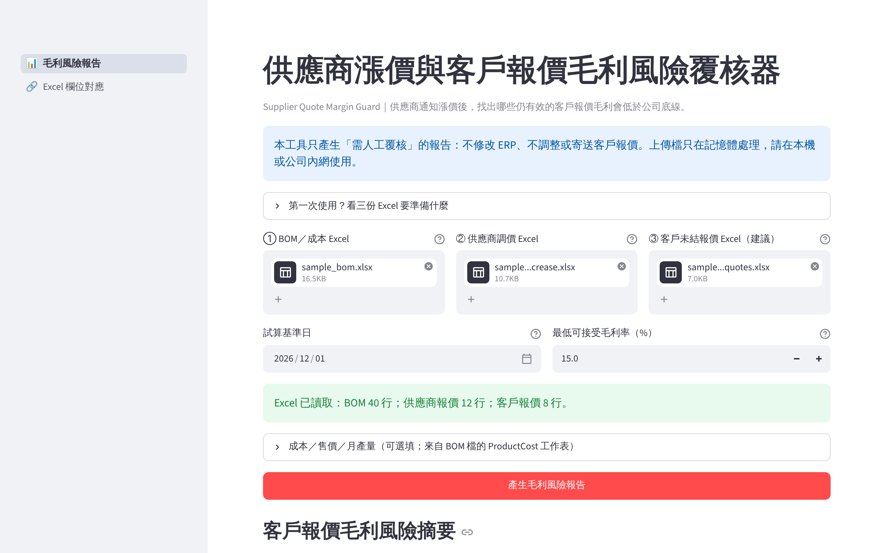
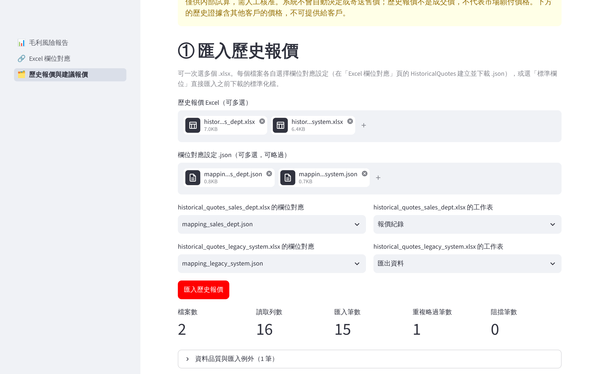
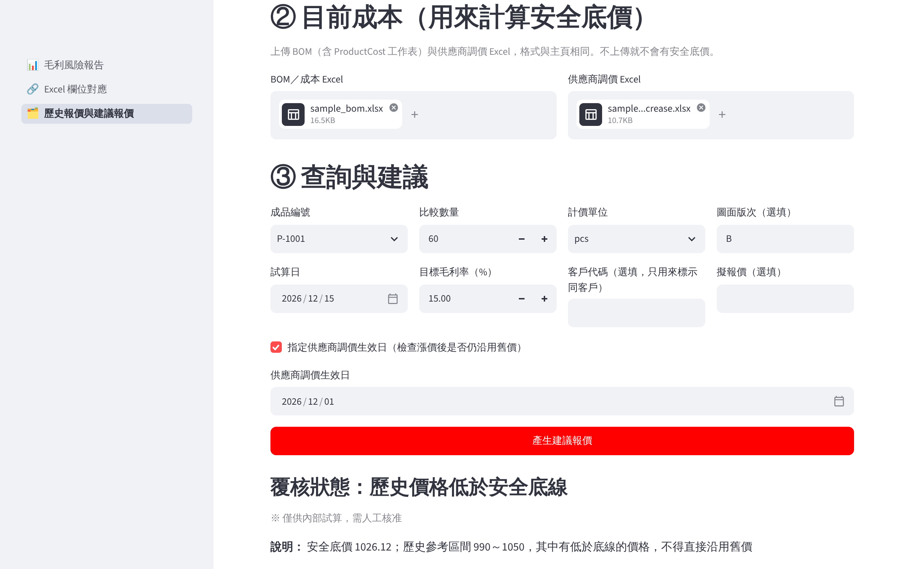

# 第一次使用教學

以下畫面都使用 `samples/` 的**合成資料**。

- 還沒安裝？請看 `docs/LOCAL_DEPLOYMENT.md` 第 2 節（Windows）或第 3 節（macOS）；安裝後雙擊 `start_windows.bat` 或 `start_macos.command` 啟動。
- 想一次確認安裝、三條操作流程與備份還原是否正常：請照 `docs/FIRST_USE_CHECKLIST.md` 逐項勾選。

## 步驟 1：上傳三份 Excel，設定日期與毛利底線

1. **① BOM／成本 Excel**：每件成品用了哪些料、各用多少、原單價；同一個檔案再附上 `ProductCost` 工作表，提供人工、製費與其他成本。
2. **② 供應商調價 Excel**：哪些料漲價、新單價、從哪天生效。
3. **③ 客戶未結報價 Excel**：仍有效的客戶報價。
4. **試算基準日**：想模擬的日期。系統只會套用這一天有效的價格與報價。
5. **最低可接受毛利率**：公司的毛利底線，預設 15%。

不清楚欄位要怎麼準備時，點畫面上的「第一次使用？看三份 Excel 要準備什麼」。

## 步驟 2：按「產生毛利風險報告」，先看摘要

- **需人工覆核**：新毛利率低於底線的報價。
- **尚符合設定底線**：毛利率仍不低於底線，但成本可能有增加。
- **無法可靠判斷**：報價或成本資料有問題，所以不顯示毛利數字。
- **不納入試算**：已取消、尚未生效或已過期的報價。

「情境成本增加」是依報價數量推估的金額，**不是**實際損失。

## 步驟 3：看需人工覆核清單

- 清單依風險排序，第 1 列最需要優先處理。
- 「問題原因」說明低於底線多少、是調價前就已低於底線，還是漲價後才低於，以及要回到底線至少需要多少單價。
- 往下捲動可以看到成本影響與資料例外。

## 步驟 4：下載 Excel 報告

按「下載可稽核 Excel 報告」，取得 `result.xlsx`。內容範例見 `demo/example_result.xlsx`。各工作表的說明見 README 第 10 節。

## 欄位名稱不一樣時：Excel 欄位對應

1. 在左側選單點「Excel 欄位對應」。
2. 上傳 ERP 匯出檔，選擇工作表，**逐欄**選擇對應的欄位。
3. 下載 `standardized.xlsx` 與 `field_mapping.json`。
4. 回到主頁，把 `standardized.xlsx` 分別上傳到 ①、②、③。

練習用的檔案：`samples/sample_erp_export.xlsx` 搭配 `samples/sample_field_mapping.json`。

## 歷史報價與建議報價

1. 在左側選單點「歷史報價與建議報價」。
2. 上傳 `samples/historical/` 的兩份歷史報價檔，以及兩份 `mapping_*.json`。
3. 每個檔案選擇對應的設定，按「匯入歷史報價」，查看匯入筆數、重複筆數與例外。
4. 在「② 目前成本」上傳 `sample_bom.xlsx` 與 `sample_price_increase.xlsx`。
5. 查詢條件：P-1001、60 件、圖面版次 B、試算日 2026-12-15；勾選調價生效日 2026-12-01。
6. 按「產生建議報價」。

結果是「歷史價格低於安全底線」：安全底價 1,026.12，歷史區間 990～1,050。
報告**僅供內部試算，需人工核准**，而且含其他客戶的價格，不可提供給客戶。

## 報價工作台與案件工作台

- 報價工作台（批次成本、數量階梯、版本比較、客戶草稿）：README 第 30～36 節；練習步驟見 `docs/FIRST_USE_CHECKLIST.md` 第 5 節。
- 案件工作台（RFQ、案件狀態、實際成本、備份還原）：README 第 38 節；練習步驟見 `docs/FIRST_USE_CHECKLIST.md` 第 6 節。

## 看到錯誤時

請照 README 第 15 節「常見錯誤」處理；安裝、資料庫、備份或連接埠的問題見 `docs/LOCAL_DEPLOYMENT.md` 第 11 節。每一個例外都會寫出工作表、Excel 列號與原因，修正原始 Excel 後重新上傳即可。

## 操作影片

`docs/media/demo_walkthrough.webm`：以合成資料錄製的瀏覽器操作過程（無聲）。
