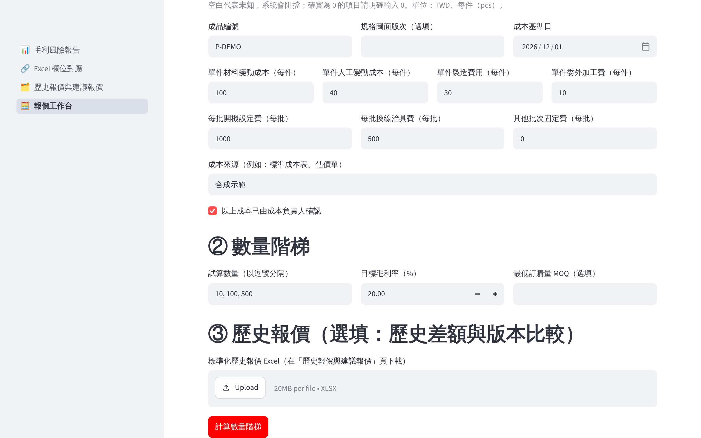
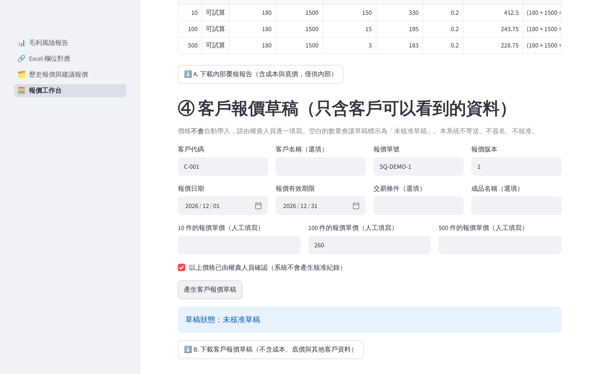

# 使用手冊：Supplier Price Impact 企業成本與報價決策系統

本手冊是完整的操作說明，涵蓋資料準備、欄位說明、操作步驟、計算口徑、報告解讀與常見錯誤。產品介紹請見 [README](../README.md)；安裝與部署請見 [`LOCAL_DEPLOYMENT.md`](LOCAL_DEPLOYMENT.md)。

範例 Excel 全部是人工建構的合成資料，不是任何企業或 ERP 的真實資料。本系統未取得任何 ERP 廠商的認證或合作；系統**沒有**使用 AI 或機器學習模型，全部是可以逐條檢查的規則。

> **一句話：** 供應商漲價時，找出哪些客戶報價跌破毛利底線；新詢價進來時，把散落各處的歷史報價找出來，並和目前成本的安全底價一起比對，產出**需要人工核准**的報價建議。

### 目錄

- 第 1～5 節：解決的問題、使用者、優勢、與 Excel 和 ERP 的差異
- 第 6～12 節：毛利風險覆核（三份 Excel、欄位、操作、範例、報告、例外、計算口徑）
- 第 21～26 節：**歷史報價記憶庫與建議報價**（歷史 Excel、匯入、查詢、建議、風險解讀、範例與報告）
- 第 13～20 節：安裝、Docker、測試、常見錯誤、FAQ、資料安全、限制、欄位對應
- 第 27～29 節：導入流程、人工導入服務、商業化現況
- 第 30～36 節：**報價工作台**（批次成本、數量階梯、版本比較、客戶草稿、內部與對外文件的差異）
- 第 38 節：**案件工作台**（詢價案件、狀態、報價版本、成交與實際成本、差異分析、備份與還原）

### 5 分鐘看懂（全部是合成資料）

- 範例結果：[`demo/example_result.xlsx`](../demo/example_result.xlsx)（由三份 `samples/` 檔案產生，可用 `python demo/build_example_result.py` 重新產生）
- 建議報價範例報告：[`demo/quote_recommendation_example.xlsx`](../demo/quote_recommendation_example.xlsx)（`python demo/build_quote_recommendation_example.py`）
- 第一次使用教學（有截圖）：[`docs/FIRST_TIME_GUIDE.md`](FIRST_TIME_GUIDE.md)
- 60 秒展示腳本：[`docs/DEMO_SCRIPT.md`](DEMO_SCRIPT.md)
- 一頁式介紹：[`docs/ONE_PAGER.md`](ONE_PAGER.md)
- 服務內容與限制（草案）：[`docs/SERVICE_SCOPE.md`](SERVICE_SCOPE.md)
- 操作影片（無聲）：[`docs/media/demo_walkthrough.webm`](media/demo_walkthrough.webm)

---

## 1. 解決什麼業務問題

少量多樣的製造業常同時有幾十張還在有效期間內的客戶報價。供應商一通知漲價，通常要：

1. 採購整理漲價料號；
2. 成本會計逐一找出用到這些料的成品並重算成本；
3. 業務再拿著新成本，一張張檢查已經報出去的價格還有沒有利潤。

這三步分散在不同人、不同 Excel，最常見的問題是：**漏算共用料件**、**把錯誤報價當成沒漲價**、**只看材料不看人工製費**，以及**沒有人知道哪張報價最危險**。

本工具把這三步串成一份可稽核的覆核報告，並把需要主管決定的報價排在最前面。

## 2. 使用者是誰

| 使用者 | 用途 |
|---|---|
| 業務主管 | 看「需人工覆核清單」，決定哪些報價要重談、哪些先維持 |
| 採購主管 | 確認漲價料號、供應商、單位、生效日是否正確，處理阻擋例外 |
| 成本會計 | 核對每件成品的材料、人工、製費與逐行稽核 |
| 廠長／經營者 | 看摘要：受影響成品數、需覆核報價數、情境金額 |

## 3. 系統主要優勢

- **可追溯**：每個數字都附原始檔案、工作表與 Excel 列號，以及計算式。
- **寧可不給，也不給錯**：成本不完整、幣別或稅別不明、歷史資料不足時，直接說明原因，不硬算出看似可信的數字。
- **安全底價無條件進位**：不會因為四捨五入而略低於毛利底線。
- **歷史證據逐筆說明**：哪些報價被選入、哪些被排除、為什麼，都寫清楚。
- **資料不離開公司**：沒有外部 API、AI 服務或資料庫；上傳檔只在記憶體中處理。

### 為什麼需要這個工具

- 供應商漲價通常只列料號，不會告訴你哪些成品、哪些客戶報價會受影響。
- ERP 正式改價要走流程，改之前就需要一份可以討論的影響報告。
- 漲價幅度看起來不大的料件，可能出現在很多成品，合計起來會吃掉整張報價的毛利。

## 4. 和一般 Excel 手工作業的差異

| 項目 | 手工 Excel | 本工具 |
|---|---|---|
| 共用料件 | 容易漏掉其中幾個成品 | 每個 BOM 行都逐一配對 |
| 錯誤報價（空白、0、文字、USD、每百件） | 常被當成沒漲價或直接相乘 | 一律列為阻擋例外，不猜、不換算 |
| 成本不完整 | 部分加總看起來像完整成本 | 標示「無法可靠判斷」，不顯示數字 |
| 毛利底線所需單價 | 常用四捨五入，結果可能略低於底線 | 以 Decimal **無條件進位**到小數兩位 |
| 追溯 | 公式散落各處 | 每列附原始 Excel 列號與原因 |
| 歷史報價 | 憑記憶或翻舊檔，不同人找到不同價格 | 多檔匯入、去除重複、逐筆說明可比較與否 |
| 漲價後沿用舊價 | 不容易發現 | 自動比對調價前後的報價並提出警示 |
| 公式注入 | 從 ERP 帶出的 `=` 開頭文字可能被當成公式 | 匯出時一律轉為純文字 |

## 5. 與 ERP 的關係與限制

> **輔助分析，不取代 ERP。**


- 本工具**不是 ERP**，也不取代 ERP 的標準成本、會計憑證或正式報價流程。
- 只讀取你提供的 Excel，**不會**寫回 ERP、**不會**修改或寄送客戶報價、**不會**通知客戶。
- 報告中的「維持底線所需最低單價」只是**計算參考**，不代表客戶會接受，也不代表企業有權要求客戶接受新價格。
- 所有結果都需要人工覆核後，才由企業依自己的流程決定是否調整。

## 6. 三份 Excel 如何準備

所有工作表都是：**第 1 列為欄位名稱，資料從第 2 列開始**。欄位順序不限，系統依欄位名稱讀取；多出來的欄位會保留但不影響計算。

| 檔案 | 工作表 | 範例檔 |
|---|---|---|
| ① BOM／成本 | `BOM`（必要）、`ProductCost`（計算毛利率需要） | `samples/sample_bom.xlsx` |
| ② 供應商調價 | `PriceIncrease` | `samples/sample_price_increase.xlsx` |
| ③ 客戶未結報價 | `OpenQuotes` | `samples/sample_open_quotes.xlsx` |

建議先用範例檔操作一次，再依範例格式整理自己的資料。

## 7. 欄位說明

### ① `BOM` 工作表

| 欄位 | 必填 | 意義 |
|---|---|---|
| 成品編號 | 是 | 成品料號；以文字讀取，保留前導零 |
| 成品名稱 | 是 | 顯示用 |
| 子件料號 | 是 | 用來和供應商報價配對 |
| 子件名稱 | 是 | 顯示用 |
| 單位 | 是 | 必須和供應商報價單位**完全相同**（不自動換算 g／kg） |
| 用量 | 是 | **每 1 件成品**使用的數量，必須大於 0 |
| 原單價 | 是 | TWD、每 1 個 BOM 單位；可為 0 |
| 工廠代碼、BOM版本、BOM狀態、生效起日、生效迄日、BOM基準產量、成品單位、子件類型、供應商代碼、原單價幣別、原單價計價數量、已展開至最底層 | 否 | 有提供時會檢查：只接受單一工廠與版本、「已核准」、基準產量 1、成品單位 pcs、已展開的採購件、TWD、計價數量 1 |

### ① `ProductCost` 工作表（同一個 BOM 檔內）

| 欄位 | 意義 |
|---|---|
| 成品編號 | 對應 BOM |
| 單件人工成本、單件製造費用、單件其他成本 | 三者都有效時，才會計算完整成本與毛利率 |
| 未稅銷售單價、銷售幣別、預估月產量 | 用於成品層級的毛利率與月成本影響（可省略） |

上傳後可在畫面上的表格直接修改；**留空代表未知**，系統不會自行補值。

### ② `PriceIncrease` 工作表

| 欄位 | 必填 | 意義 |
|---|---|---|
| 子件料號、子件名稱 | 是 | 漲價的料號 |
| 單位 | 是 | 新單價對應的單位 |
| 幣別 | 是 | 只接受 TWD |
| 新單價 | 是 | 必須大於 0；空白、0、文字都會阻擋 |
| 生效日 | 是 | 試算基準日當天或之前生效才會套用 |
| 供應商代碼、工廠代碼、價格迄日、報價狀態、計價數量、報價單號 | 否 | 有提供時會檢查供應商、工廠是否一致，報價狀態須為「核准」，計價數量須為 1 |

### ③ `OpenQuotes` 工作表

| 欄位 | 必填 | 意義 |
|---|---|---|
| 報價單號、行號 | 是 | 兩者合起來是唯一鍵；重複時兩列都會阻擋 |
| 成品編號 | 是 | 對應 BOM 的成品 |
| 客戶代碼 | 是 | 以文字讀取，保留前導零 |
| 未稅報價單價 | 是 | 每件的未稅價，必須大於 0 |
| 報價幣別 | 是 | 只接受 TWD，不會自動查匯率 |
| 報價數量 | 是 | 大於 0 的整數件數；空白不會被當成 0 |
| 生效日、截止日 | 是 | 有效期間**包含**起日與截止日；生效日晚於截止日會阻擋 |
| 報價狀態 | 是 | 只有「有效」會試算；「已取消／取消／失效／已失效／作廢／已作廢」記錄後不納入；空白或其他文字會阻擋 |

## 8. 操作步驟

1. 啟動程式（見第 13 節），瀏覽器開啟 `http://127.0.0.1:8501`。
2. **先選擇報告類型**（沒有預設值）：

| 報告類型 | 需要的 Excel | 內容 |
|---|---|---|
| **成本影響報告** | ① BOM／成本、② 供應商調價 | 成品成本變化、例外、逐行稽核。**不含**客戶報價風險 |
| **客戶報價風險報告** | ①、②，以及 ③ 客戶未結報價（必要） | 成本影響，加上每張客戶報價的毛利風險 |

3. 上傳該報告類型需要的 Excel。選擇「客戶報價風險報告」時，③ 還沒上傳完成或無法讀取，**就不會出現產生按鈕**，不會產生缺少報價資料的報告。
4. 選擇**試算基準日**，也就是想模擬的漲價生效日。系統不會自動使用今天的日期。
5. 設定**最低可接受毛利率**（預設 15%）。
6. （可選）展開「成本／售價／月產量」，檢查或修改 ProductCost 數值。
7. 按「**產生成本影響報告**」或「**產生客戶報價風險報告**」。
8. 確認畫面上的「**報告類型：……**」是你要的報告。Excel 的 Summary 第一列也會寫明報告類型。
9. 先看「需人工覆核清單」，再看各類例外。
10. 按「下載可稽核 Excel 報告」，取得 `result.xlsx`。

報告類型、輸入檔、日期、底線或成本只要有任何變動，畫面上的舊結果就會隱藏，必須重新產生報告。

## 9. 完整示範數字（合成資料）

試算基準日 2026-12-01，最低毛利率 15%，使用三份範例檔：

**成品成本（含模擬人工與製費）**

| 成品 | 原成本 | 新成本 | 每件增加 | 月產量 | 月成本增加 |
|---|---:|---:|---:|---:|---:|
| P-1001 | 836.60 | 872.20 | 35.60 | 400 | 14,240.00 |
| P-1002 | 282.75 | 294.20 | 11.45 | 900 | 10,305.00 |
| P-1003 | 549.00 | 566.00 | 17.00 | 600 | 10,200.00 |
| P-1004 | 830.15 | 874.55 | 44.40 | 260 | 11,544.00 |
| P-1005 | 660.20 | 684.60 | 24.40 | 320 | 7,808.00 |
| P-1006 | 503.30 | 518.30 | 15.00 | 500 | 7,500.00 |
| 合計 | | | | | **61,597.00** |

**客戶報價覆核（依風險排序）**

| 排序 | 報價 | 成品 | 單價 × 數量 | 原毛利率 | 新毛利率 | 維持 15% 最低單價 | 狀態 |
|---:|---|---|---|---:|---:|---:|---|
| 1 | SQ-2611-002 / 2 | P-1003 | 640 × 30 | 14.22% | 11.56% | 665.89 | 需人工覆核（調價前已低於底線） |
| 2 | SQ-2611-001 / 1 | P-1001 | 1,000 × 50 | 16.34% | 12.78% | 1,026.12 | 需人工覆核（漲價後才低於底線） |
| 3 | SQ-2611-004 / 1 | P-1005 | 800 × 40 | 17.48% | 14.43% | 805.42 | 需人工覆核（漲價後才低於底線） |
| … | 其他 4 筆 | | | | | | 尚符合設定底線 |
| 8 | SQ-2610-007 / 1 | P-1002 | | | | | 不納入試算（已取消） |

需人工覆核的 3 筆報價，依報價數量推估的情境成本增加合計為 **3,266.00**；全部可判斷報價合計為 **6,480.50**。

以 P-1001 這筆為例：

- 原毛利率 =（1000 − 836.60）÷ 1000 = 16.34%
- 新毛利率 =（1000 − 872.20）÷ 1000 = 12.78%，比原本下降 3.56 個百分點
- 報價情境成本增加 =（872.20 − 836.60）× 50 = 1,780.00
- 維持 15% 底線所需單價 = 872.20 ÷ 0.85 = 1,026.1176…，無條件進位為 **1,026.12**

## 10. 報告怎麼看

`result.xlsx` 有六個工作表；沒有上傳 ③ 時只有前四個。

| 工作表 | 內容 |
|---|---|
| Summary | 試算日、成品與報價的數量統計、情境金額合計、重要提醒 |
| Cost Impact | 每個成品的原／新成本、成本增加、毛利率、月成本影響；成本不完整的成品不顯示數字 |
| Exceptions | BOM 與供應商報價的例外，附原始工作表與 Excel 列號 |
| Line Audit | 每個 BOM 行實際採用的單價與金額，可逐列追溯 |
| Quote Risk | 每筆客戶報價的毛利、情境金額、所需最低單價、**覆核狀態與原因**，依風險排序 |
| Quote Exceptions | 客戶報價本身的問題（重複、空白、USD、已取消、尚未生效、已過期、成品不在 BOM 等） |

Quote Risk 的四種狀態：

| 狀態 | 意義 | 建議動作 |
|---|---|---|
| 需人工覆核 | 新毛利率低於底線 | 業務主管決定是否重新報價 |
| 尚符合設定底線 | 毛利率仍不低於底線，但成本可能增加 | 參考成本增加金額 |
| 無法可靠判斷 | 報價或成本資料有問題 | 先依原因修正資料，再重新產生 |
| 不納入試算 | 已取消、尚未生效或已過期 | 確認狀態是否正確 |

## 11. 例外處理

- **阻擋例外**：系統無法安全計算的情況，例如單位不同、USD、每百件報價、重複報價、一料多供應商、BOM 未核准、未展開半成品、客戶報價空白或為 0。受影響的成品與報價**不顯示數字**，也不會被當成 0。
- **非阻擋提醒**：例如供應商報價料號不在 BOM（M-999）、報價尚未生效。這些會列出來，但不影響其他成品。
- 處理方式：在 Exceptions 或 Quote Exceptions 找到「工作表＋Excel 列號＋原因」，回到原始 Excel 修正，再重新上傳。

## 12. 毛利率計算口徑

```text
完整單件成本 = 所有 BOM 行（用量 × 單價）＋ 單件人工 ＋ 單件製費 ＋ 單件其他成本
原估算毛利率 = (未稅報價單價 − 原完整單件成本) ÷ 未稅報價單價
新估算毛利率 = (未稅報價單價 − 新完整單件成本) ÷ 未稅報價單價
毛利率下降百分點 = (原估算毛利率 − 新估算毛利率) × 100
報價情境成本增加 = (新完整單件成本 − 原完整單件成本) × 報價數量
維持底線所需最低單價 = 新完整單件成本 ÷ (1 − 最低毛利率)，無條件進位至小數 2 位
```

- 新毛利率**低於**底線即為「需人工覆核」；剛好等於底線視為符合。
- 人工、製費、其他成本假設不隨報價數量改變。
- **報價情境成本增加是依報價數量推估的情境金額**，不是已確認訂單量，不是實際損失，也不是企業已承擔的法律責任。
- 全程使用 Decimal 計算，只在顯示與匯出時四捨五入到小數兩位；最低單價則一律無條件進位。

## 13. 啟動方式

### Python（3.11 以上）

```bash
python3.11 -m venv .venv
. .venv/bin/activate              # Windows PowerShell：.venv\Scripts\Activate.ps1
python -m pip install -r requirements-lock.txt   # 固定版本，與驗收環境相同
streamlit run app.py --server.address=127.0.0.1
```

### Docker

```bash
docker compose up --build
```

完成後瀏覽 `http://127.0.0.1:8501`。

- 服務只發布在本機 `127.0.0.1`，並以非 root 使用者執行。
- **不要**把 `docker-compose.yml` 的連接埠改成 `8501:8501`，否則同網段的人都能連線。
- 更多細節見 [`docs/DEPLOYMENT_CHECKLIST.md`](DEPLOYMENT_CHECKLIST.md)。
- Windows／macOS 安裝、資料庫位置、備份還原、更新前備份與故障復原，見 [`docs/LOCAL_DEPLOYMENT.md`](LOCAL_DEPLOYMENT.md)。
- 安裝後雙擊 `start_windows.bat`／`start_macos.command` 啟動；第一次使用請照 [`docs/FIRST_USE_CHECKLIST.md`](FIRST_USE_CHECKLIST.md) 驗收。

## 14. 測試

```bash
python -m pytest -q -rs
```

結果必須是 0 failed、0 skipped。GitHub Actions 也會在 Python 3.11 上執行同樣的測試。

驗收基準檔包括：

- `tests/fixtures/expected_result_reference.xlsx`
- `samples/sample_open_quotes.xlsx`
- `tests/fixtures/test_open_quotes_edge_cases.xlsx`

**不得為了讓測試通過而修改這些檔案。**

## 15. 常見錯誤

| 畫面訊息 | 原因與處理 |
|---|---|
| 缺少工作表「OpenQuotes」 | 工作表名稱要完全相同（大小寫、空白都算） |
| 缺少必要欄位「報價數量」 | 第 1 列的欄位名稱要和第 7 節完全相同 |
| 欄位「供應商代碼」在第 1 列重複出現 | 同名欄位只能出現一次，請刪除多餘的那一欄 |
| 不是有效日期 | 使用 Excel 日期格式，或文字 `YYYY-MM-DD` |
| 單位不一致／幣別不一致 | 先在 Excel 把單位或幣別統一，系統不會自動換算 |
| 檔案過大、資料列過多 | 單檔上限 20 MB、每個工作表上限 50,000 列；請先篩選需要的資料 |
| 成品成本不完整（無法可靠判斷） | 到 Exceptions 找出被阻擋的料號，修正後重新產生 |
| 缺少完整成本 | ProductCost 的人工、製費、其他成本有空白；補齊後才會計算毛利率 |

## 16. 常見問題（FAQ）

**Q：能直接上傳 ERP 匯出的 Excel 嗎？**
A：目前不能保證。真實 ERP 匯出檔需要先做欄位對應（見第 20 節與 `docs/CUSTOMER_ONBOARDING.md`）。

**Q：同一成品有好幾張客戶報價，會被合併嗎？**
A：不會。每一筆「報價單號＋行號」都獨立判斷。

**Q：為什麼有些報價沒有毛利率？**
A：可能是報價本身有問題（空白、0、USD、狀態不明），或成品成本不完整、缺人工製費。系統寧可不給數字，也不給可能錯誤的數字。

**Q：「維持底線所需最低單價」可以直接報給客戶嗎？**
A：不建議。它只是成本與底線的計算結果，沒有考慮客戶關係、合約與市場行情，必須由業務主管判斷。

**Q：報價情境成本增加是公司會損失的錢嗎？**
A：不是。它是用報價數量推估的情境金額；報價不一定成交，數量也可能改變。

**Q：會自動換匯或把 g 換成 kg 嗎？**
A：不會。沒有明確依據的換算會讓結果失真，所以一律列為阻擋例外。

**Q：歷史報價記憶庫會一直保存我們的報價嗎？**
A：不會。匯入的資料只在當次使用時存在記憶體中。要保留就下載「標準化歷史報價」，下次重新匯入。

**Q：系統是用 AI 算出建議價格的嗎？**
A：不是。系統沒有使用 AI 或機器學習，全部是可以逐條檢查的規則（第 24、25 節），也不會給出單一的「建議售價」。

**Q：建議報價報告可以直接寄給客戶嗎？**
A：不可以。Historical Evidence 含其他客戶的價格。報告只供內部核准使用。

**Q：為什麼明明有很多筆歷史報價，卻顯示「歷史資料不足」？**
A：請看 Historical Evidence 中每一筆的排除原因，例如舊版圖面、單位不同、含稅、數量差太多、超過兩年等。系統只用真正可以比較的報價。

## 17. 資料安全與保密

- 上傳的 Excel 只在伺服器記憶體中處理，**不會寫入磁碟**，伺服器重啟後即清除。
- 已關閉 Streamlit 使用統計，也關閉了啟動時對外查詢公開 IP 的功能。
  實測在完整操作流程中，瀏覽器端與伺服器端都沒有對外連線（見部署清單）。
- 讀取 Excel 時不執行公式；匯出時以 `=`、`+`、`-`、`@` 開頭的文字一律轉為純文字。
- 已限制上傳大小、解壓縮大小與資料列數，用來防止異常檔案。
- 歷史報價模組同樣只在記憶體中處理，不使用資料庫、不永久保存；建議報價報告含其他客戶價格，只供內部使用。
- 唯一會寫入磁碟的是「案件工作台」：必須勾選啟用並輸入本機資料庫路徑才會保存（見第 38 節）。它不保存上傳的原始 Excel；SQLite 檔案**沒有加密**。
- 本工具**沒有登入或權限系統**。只在本機或公司內網使用，**不要**把真實的 BOM、成本或客戶報價上傳到公開 Demo 主機。
- 下載的 `result.xlsx` 含成本與毛利資訊，請依公司的保密規定保存與傳送。

## 18. 已知限制

- 只支援單階、已展開的 BOM，以及單一工廠、單一 BOM 版本。
- 只支援 TWD 與每件（pcs）計價；不支援匯率、單位換算、每百件報價、數量階梯價。
- 一個料號在同一試算日只能有一筆可用的供應商報價；有多家供應商時會阻擋，需要人工選定。
- 人工、製費、其他成本假設是固定的每件成本。
- 沒有登入、權限。除「案件工作台」的本機 SQLite（預設關閉、單人使用）外，沒有資料庫。
- 只用合成資料驗收過，尚未用真實企業資料驗證。

- 歷史報價：只比對成品編號完全相同的報價，不做圖面、材質或製程相似度推估；不換算匯率、含稅價或單位；門檻是預設值；歷史報價不是成交價。
- 不產生對外報價單、不自動寄送、不估算成交率。

## 19. 可能適合的企業

- 金屬加工、機械零組件、設備組裝、中小型 OEM／ODM 代工廠
- 少量多樣、同時有多張有效客戶報價
- 能從 ERP 或 Excel 匯出單階 BOM、材料單價與人工製費
- 供應商調價頻繁，業務與成本部門需要快速討論是否重新報價

不適合的情況：需要多階 BOM 展開、多幣別、多工廠成本，或希望直接寫回 ERP。

## 20. 真實 ERP 匯出檔需先做欄位對應

鼎新、正航、SAP、Oracle、Odoo 等 ERP 的欄位名稱、單位、成本口徑、報價狀態文字，會因版本與導入設定而不同。
本工具**沒有**宣稱可以直接讀取任何 ERP 的原生匯出檔。

導入時需要先完成以下工作：

1. 取得經授權、已去識別化的匯出樣本。
2. 逐欄對應到第 7 節的欄位，例如 ERP 的「品號」對應「成品編號」、「報價有效迄日」對應「截止日」。
3. 確認成本口徑：使用標準成本、最近進價還是移動平均。
4. 用一小批資料人工驗算，簽核後再正式使用。

詳細流程見 [`docs/CUSTOMER_ONBOARDING.md`](CUSTOMER_ONBOARDING.md)。

### 使用「Excel 欄位對應」頁面

ERP 匯出檔的欄位名稱和本工具不同時，不必手動改 Excel：

1. 在左側選單點「**Excel 欄位對應**」。
2. （可略過）載入上次儲存的對應設定 `.json`。
3. 分別上傳 BOM、ProductCost、PriceIncrease、OpenQuotes 的來源 Excel，可以是不同檔案，也可以是同一個檔案的不同工作表。
4. 選擇來源工作表，看前 5 列預覽，再**逐欄**選擇對應的來源欄位。所有欄位一開始都是「不對應」，系統不會自動猜測。
5. 按「產生標準化 Excel」，系統會檢查兩件事：
   - 必要欄位是否都有指定。
   - 同一個來源欄位是否被重複使用。
6. 下載 `standardized.xlsx`，把**同一個檔案**分別上傳到主頁的 ①、②、③。
7. 下載 `field_mapping.json`，下次就能直接載入。

對應時的規則：

- 數值只會原樣複製。系統不換算單位或幣別、不補前導零、不把空白填成 0、不合併供應商。
- 識別碼如果在 Excel 中是數值格式，會轉成文字並提出提醒，因為前導零可能早已遺失。
- 每一列都保留「來源Excel列號」，方便回頭追查。

範例：`samples/sample_erp_export.xlsx` 搭配 `samples/sample_field_mapping.json`，對應後的結果與三份標準範例完全相同。
其中的欄位名稱是合成的，**不代表任何特定 ERP 的原生格式**。

---

## 21. 歷史報價記憶庫：解決的問題

- 歷史報價散落在不同人的 Excel 中，新人不知道以前類似的料號報過多少。
- 同一料號在不同日期、客戶、數量下報出不一致的價格，沒有人發現。
- 材料漲價後，業務仍然沿用舊價格。
- 資深估價員離職後，報價依據跟著消失。

本模組的做法：把多份歷史報價 Excel 匯入成同一種格式，用**明確的規則**找出可比較的報價，再和目前成本算出的**安全底價**一起呈現，最後由人核准。

**本模組不會**：
- 自動寄送報價、承諾售價、設定折扣
- 推估成交率
- 把成交狀態未知的報價當成成交
- 宣稱「學會」市場價格

## 22. 歷史報價 Excel 的用途與欄位

歷史報價檔可以來自不同系統、不同人，欄位名稱和順序都可以不同。每個檔案各自建立一份欄位對應設定即可。

| 欄位 | 必要 | 說明 |
|---|---|---|
| 報價單號、報價行號 | 是 | 文字；保留前導零 |
| 報價日期 | 是 | Excel 日期或 `YYYY-MM-DD` |
| 客戶代碼、成品編號 | 是 | 文字；保留前導零 |
| 報價數量 | 是 | 大於 0；空白不視為 0 |
| 計價單位 | 是 | 例如 pcs、set；不做單位換算 |
| 幣別 | 是 | 只有 TWD 可以直接比較；不推測匯率 |
| 報價單價 | 是 | 每 1 計價單位 |
| 稅別 | 是 | 「未稅」或「含稅」；空白或其他文字＝不明。只有未稅可以比較，不自動換算營業稅 |
| 報價版本、成品名稱、規格圖面版次、材質、製程類別、報價狀態、成交狀態、交期、備註 | 否 | 沒有就留空，系統不會補值 |

- **成交狀態**只認得「成交／未成交／未知」；空白或其他文字一律是**未知**，絕不當成成交。
- 完整規則見 [`docs/HISTORICAL_QUOTE_PRODUCT_SPEC.md`](HISTORICAL_QUOTE_PRODUCT_SPEC.md)。

## 23. 歷史報價匯入操作

1. 第一次使用某種格式的檔案時，到「**Excel 欄位對應**」頁，在 **HistoricalQuotes** 區塊上傳該檔案，逐欄選擇對應，然後下載 `field_mapping.json`，可依檔案來源命名。
2. 到「**歷史報價與建議報價**」頁的「① 匯入歷史報價」：
   - 上傳多個歷史報價 Excel。
   - 上傳各自的對應設定 `.json`。
   - 每個檔案選擇要用哪一份對應，以及工作表。
3. 按「**匯入歷史報價**」，查看匯入結果：檔案數、讀取列數、匯入筆數、重複略過筆數、阻擋筆數，以及每一筆例外的來源與原因。
4. 下載「標準化歷史報價」。下次直接匯入這份檔案即可，選「標準欄位，不需對應」。

匯入規則：

| 情況 | 處理方式 |
|---|---|
| 同一筆報價從兩個系統各匯出一次（核心欄位相同） | 只保留一筆 |
| 報價單號＋行號＋版本相同，但價格等核心欄位不同 | 全部阻擋，請人工確認 |
| 同一筆報價有多個修訂版本 | 全部保留，並依報價日期標示最新版本；同一天有多個版本時不猜測 |

上限：每次最多 20 個檔案，累計 100 MB、100,000 列。

## 24. 相似案件查詢與建議報價操作

在「③ 查詢與建議」輸入：

- **成品編號**、**比較數量**、**計價單位**、**試算日**（必填）
- **圖面版次**（建議填寫，可以檢查舊版圖面風險）
- **客戶代碼**（選填，只用來標示是否為同一客戶，不影響是否列入比較）
- **目標毛利率**（預設 15%）
- **擬報價**（選填）
- **供應商調價生效日**（選填，用來檢查漲價後是否仍沿用舊價）

如要計算安全底價，請在「② 目前成本」上傳 BOM（含 ProductCost）與供應商調價 Excel。最後按「**產生建議報價**」。

**歷史報價的比較規則**（每一筆都會標示選入或排除，以及原因）：

| 條件 | 規則 |
|---|---|
| 成品編號 | 必須完全相同（不比對名稱相似度） |
| 版本 | 只用同一報價的最新版本 |
| 幣別、稅別 | TWD、未稅 |
| 計價單位 | 必須相同 |
| 圖面版次 | 指定時必須相同；歷史資料沒填版次時列為 B 級，並提醒 |
| 數量 | 比較數量的 0.5～2 倍 |
| 日期 | 試算日之前 730 天內，不使用晚於試算日的報價 |
| 統計 | 至少 3 筆才計算最低、中位數、最高；不足時顯示「**歷史資料不足**」，不提供區間 |

0.5～2 倍、730 天、3 筆這些門檻都是**預設規則**，尚未經真實客戶驗證，導入時請和客戶確認。

## 25. 報價風險解讀

**覆核狀態**

| 狀態 | 意義 | 建議動作 |
|---|---|---|
| 無法提供安全底價 | 成本不完整、缺人工製費、成品不在 BOM，或計價單位不是 pcs | 先補齊成本資料 |
| 歷史資料不足 | 安全底價可以計算，但可比較的歷史報價少於 3 筆 | 以安全底價為下限，由主管判斷 |
| 歷史價格低於安全底線 | 歷史低價比目前安全底價還低 | **不得直接沿用舊價** |
| 可參考歷史區間 | 歷史區間都不低於安全底價 | 可以參考，但仍需人工核准 |

**安全底價** = 新完整單件成本 ÷（1 − 目標毛利率），無條件進位到小數兩位。報告中會列出完整的計算式。

**警示**

| 警示 | 說明 |
|---|---|
| 歷史價格低於安全底線 | 列出是哪幾筆報價 |
| 同條件價格差異過大 | （最高 − 最低）÷ 中位數超過 30% |
| 舊版價格風險 | 最近一筆報價的圖面版次和這次不同或未知 |
| 材料漲價後仍沿用舊價 | 調價生效日之後的報價，和調價前最近一筆價格相同 |
| 價格單位不一致 | 同成品有其他計價單位的報價，已排除 |
| 歷史資料品質不足、缺少目前完整成本 | 說明缺少什麼 |
| 擬報價低於安全底線 | 有輸入擬報價時才檢查 |

## 26. 建議報價範例與報告（合成資料）

以 `samples/historical/` 的兩份歷史報價檔，以及 `samples/sample_bom.xlsx`、`samples/sample_price_increase.xlsx` 為例。查詢條件為 P-1001、60 件、pcs、圖面版次 B，試算日 2026-12-15，目標毛利率 15%，調價生效日 2026-12-01。

| 項目 | 結果 |
|---|---|
| 匯入 | 2 個檔案、16 列 → 15 筆；其中 1 筆是兩個系統重複匯出的同一筆報價 |
| 候選報價 | 11 筆；選入 3 筆，其他 8 筆各附排除原因（舊版圖面、非最新版本、USD、含稅、單位 set、數量 1,000、超過兩年） |
| 歷史參考 | 990～1,050，中位數 1,050（成交 2 筆、未知 1 筆） |
| 安全底價 | 872.20 ÷ 0.85 = 1,026.1176… → **1,026.12** |
| 覆核狀態 | **歷史價格低於安全底線**（990 < 1,026.12） |
| 警示 | 材料漲價後仍沿用舊價（2026-12-10 報 1,050，和 9 月相同）；價格單位不一致（另有 set 報價） |

**報告工作表**（`quote_recommendation_internal.xlsx`，範例見 `demo/quote_recommendation_example.xlsx`）：

| 工作表 | 內容 |
|---|---|
| Summary | 狀態、安全底價、歷史區間、使用限制與保密提醒 |
| Quote Recommendation | 查詢條件、成本與安全底價計算式、歷史統計、缺少的資料、人工核准欄 |
| Historical Evidence | 每一筆候選報價的判定、原因與來源。**含其他客戶的價格，屬內部資料，不可提供給客戶** |
| Price Exceptions | 每一項警示的嚴重度、說明與依據 |
| Data Quality | 匯入統計，以及每一筆匯入例外的來源與原因 |

每個工作表的第一列都標示「**僅供內部試算，需人工核准**」。本系統**不產生**對外報價單；給客戶的報價請由業務另外製作，而且**不可附上**歷史證據。

## 27. 導入流程

依 [`docs/delivery/`](delivery/README.md) 的流程進行：

1. 訪談與展示（使用合成資料）
2. 資料授權與去識別化
3. 準備資料：三份 Excel，以及歷史報價檔
4. 欄位對應，並保存 `.json`
5. 確認成本口徑
6. 產出報告
7. 人工驗收，手算抽查
8. 報告說明
9. 清除資料

第一次導入時，請和客戶確認第 24 節的預設門檻是否符合他們的習慣。

## 28. 可提供的人工導入服務（草案）

- 欄位對應協助
- 成本口徑確認
- 產出並說明報告
- 陪同人工驗收

服務範圍、待測價格（NT$3,000～8,000／次，**尚未經市場驗證**）與不包含的項目，見 [`docs/delivery/07_SERVICE_PACKAGE.md`](delivery/07_SERVICE_PACKAGE.md)。法律條款需經專業人士審閱。

## 29. 商業化現況與未經驗證事項

| 項目 | 現況 |
|---|---|
| 程式功能 | 已完成（含報價工作台），並通過自動化測試、瀏覽器實測與 Docker 驗證（全部使用合成資料）；**沒有**通過任何真實 ERP 或客戶驗收 |
| 真實客戶資料 | **沒有** |
| 客戶數量、成交、評價 | **沒有**任何紀錄 |
| 節省時間、提升營收 | **沒有**實測數據，不做任何宣稱 |
| ERP 認證 | **沒有** |
| 價格 | 待市場驗證的假設 |

商業化之前需要真人完成的驗證，見 [`docs/RELEASE_GATE.md`](RELEASE_GATE.md) 第 4 節。

## 30. 報價工作台：解決的問題

少量多樣的製造業最常遇到的報價問題：

- 10 件和 500 件的開機、換線、治具費差很多，用同一個單價報價，小量訂單會虧錢。
- 同一張報價單改了好幾版，主管不知道為什麼改價、改了多少。
- 把內部的試算表直接寄給客戶，結果洩漏了成本或其他客戶的價格。

報價工作台的流程：

1. 選擇成本模式，輸入或上傳成本。
2. 計算多個數量的安全底價（試算）。
3. （選填）比較報價版本。
4. 下載內部覆核報告。
5. 由人填寫正式售價。
6. 下載客戶報價草稿。

## 31. 兩種成本模式與批次成本計算

| 模式 | 適合情況 | 批次固定費 |
|---|---|---|
| **既有完整單件成本** | 只有主頁使用的 BOM＋ProductCost | **不另加**。既有製費可能已包含批次費用，避免重複計算 |
| **明細批次成本** | 有每件變動成本與每批固定費的明細 | 依明細攤提，**不使用** ProductCost |

兩種模式**不可混用**。

明細批次成本可以用「手動輸入」，或上傳 `BatchCost` Excel（範例：`samples/batch_cost/batch_cost_sample.xlsx`）。欄位名稱不同時，先用「Excel 欄位對應」頁的 BatchCost 區塊轉換。

| 欄位 | 口徑 |
|---|---|
| 單件材料變動成本、單件人工變動成本、單件製造費用、單件委外加工費 | 每 1 pcs、TWD |
| 每批開機設定費、每批換線治具費、其他批次固定費 | 每批、TWD |
| 成本基準日 | 不可晚於試算日；早於試算日超過 365 天會提醒 |
| 成本來源、成本完整性狀態 | 狀態必須是「已確認」 |

**空白代表未知，系統會阻擋；確實為 0 的項目必須明確填 0。** 系統不會從既有成本推測材料、人工、製費的比例，也不會拿舊報價當成本。

## 32. 如何閱讀數量階梯

```text
每件情境成本     = 單件變動成本 + 批次固定成本 ÷ 數量
安全底價（試算） = 每件情境成本 ÷ (1 − 目標毛利率)，無條件進位到小數兩位
```

**範例（合成資料）**：單件變動成本 180、每批固定成本 1,500、目標毛利率 20%

| 數量 | 每件分攤固定費 | 每件情境成本 | 安全底價（試算） |
|---:|---:|---:|---:|
| 10 | 150 | 330 | 412.50 |
| 100 | 15 | 195 | 243.75 |
| 500 | 3 | 183 | 228.75 |



- **低於最低訂購量（MOQ）**的數量不提供底價。
- 有歷史報價時，會顯示「底價與歷史中位數差額」；歷史資料不足時不顯示。
- 系統**沒有**模擬原料議價、良率、工時、委外價隨數量的變化。
- 安全底價只是下限，**不是**系統核准的正式售價。

## 33. 如何比較報價版本

上傳標準化歷史報價後，選擇報價單號、行號，以及兩個版本，然後按「比較兩個版本」。

- **先後判斷**：依報價日期。同一天的兩個版本，必須由使用者指定哪一版較新，否則顯示「版本先後無法判定」；系統不依版本號猜測。
- **單價差額**：只有幣別、計價單位、稅別（未稅）、數量都相同時才計算；數量不同時改看金額差額。
- **變更原因**：只顯示人工輸入的內容，系統不推測。

## 34. 如何產生客戶報價草稿

1. 完成數量階梯後，在「④ 客戶報價草稿」填寫客戶代碼、報價單號、有效期限等資料。
2. 在每個數量**自己填寫**報價單價。系統不會自動帶入任何價格。
3. 確認價格後勾選確認，按「產生客戶報價草稿」，再下載。



- 有任何價格空白，或沒有勾選確認時，草稿會標示「**未核准草稿**」。
- 草稿只有一張工作表，只包含允許清單內的欄位；系統不寄送、不簽名、不核准。

## 35. 內部覆核報告與客戶草稿的差異

> **客戶報價草稿不是正式報價單。** 系統只產生草稿：
> - 未填價或未勾選確認 → 標示「未核准草稿」。
> - 已填價並確認 → 標示「報價草稿（價格已人工填寫，本系統不提供核准或簽名）」。
>
> 正式報價單必須依公司既有流程，由權責主管核准後另行製作或用印，例如 ERP 報價單或公司範本。本系統不產生正式報價單、不簽名、不寄送。


| | A. 內部覆核報告 | B. 客戶報價草稿 |
|---|---|---|
| 檔名 | `quote_workbench_internal.xlsx` | `customer_quote_draft.xlsx` |
| 內容 | 成本口徑、批次分攤、安全底價與計算式、歷史差額、版本比較 | 客戶、報價單號、數量、單位、幣別、人工填寫的單價、合計、交期、交易條件 |
| 成本、底價、毛利 | 有 | **沒有** |
| 其他客戶資料 | 可能有（歷史依據） | **沒有** |
| 可以給客戶嗎 | **不可以** | 由權責人員確認後才可以 |

兩份檔案分別產生、分別下載。輸入資料、毛利率、數量或版本有任何變動，舊的結果就不能再下載。

## 36. 報價工作台的常見錯誤與不支援情境

| 狀況 | 處理方式 |
|---|---|
| 「空白代表未知，不可當作 0」 | 確實為 0 就明確填 0 |
| 「成本完整性狀態」不是已確認 | 請成本負責人確認後再勾選 |
| 「數量必須是正整數」 | 用逗號分隔，例如 `10, 100, 500` |
| 「一份客戶草稿只能有一種幣別」 | 分開產生草稿 |
| 「版本先後無法判定」 | 指定哪一版較新 |

**不支援**：
- 匯率、稅別、單位換算
- 數量對材料、良率、工時的影響
- CAD 估價、自動寄送、自動核准
- 公司抬頭或 Logo 版面
- ERP 寫回

**尚未完成的驗證**：真實客戶資料、真人操作、付費意願。

## 37. 公開網站（`web/`，尚未部署）

`web/` 是純靜態的繁體中文網站，內容包括：
- 產品介紹、適用產業、企業版說明、安裝方式、常見問題、隱私說明
- 4 個免費試算工具
- 6 篇報價實務教學

**網站界線：**
- **不接受任何 Excel 上傳**，沒有表單，也沒有任何外部資源、分析工具或廣告。
- 試算工具在瀏覽器內以有理數計算，最低售價一律無條件進位，輸入的數字不會送出。
- `web/demo/` 是**合成資料示範**：建置時用 `core/` 和 repo 中的合成範例預先算好結果，輸出成靜態頁面。公開網站因此沒有任何伺服器程式，也沒有上傳路徑。
- 頁面由 `web_src/build_site.py` 依 `web_src/content/` 的內容產生；部署前需把其中的 `BASE_URL`（目前是 `https://example.com/`）改成正式網域，再重新產生。

本機預覽：

```bash
python web_src/build_site.py
python -m http.server 8000 --bind 127.0.0.1 --directory web
```

然後開啟 `http://127.0.0.1:8000`。

是否公開部署、使用哪個網域與託管平台，需要由你決定並授權（見 `docs/PUBLIC_LAUNCH_DECISION.md`、`docs/launch/USER_DECISIONS.md`）。上線準備文件都在 `docs/launch/`。

### 專案文件

| 文件 | 內容 |
|---|---|
| [`docs/IMPLEMENTATION_SPEC.md`](IMPLEMENTATION_SPEC.md) | 原始成本試算規格與公開 ERP 參考資料 |
| [`docs/PRODUCT_DECISION.md`](PRODUCT_DECISION.md) | 產品決策紀錄；分開列出已證實事實、推論與未驗證假設 |
| [`docs/DEPLOYMENT_CHECKLIST.md`](DEPLOYMENT_CHECKLIST.md) | 部署與實際驗收紀錄 |
| [`docs/CUSTOMER_ONBOARDING.md`](CUSTOMER_ONBOARDING.md) | 客戶導入與欄位對應流程 |
| [`docs/delivery/11_TRIAL_KIT.md`](delivery/11_TRIAL_KIT.md) | 第一位客戶試用工具包（驗收清單、訪談題目、5 分鐘 Demo、回饋表、試探性報價） |
| [`docs/delivery/README.md`](delivery/README.md) | 客戶交付工具包：需求表、授權檢查、確認表、驗收表、服務範圍、FAQ、資料清除 |
| [`docs/GO_TO_MARKET.md`](GO_TO_MARKET.md) | 目標客戶、訪談題目、待測定價 |
| [`docs/WORK_LOG.md`](WORK_LOG.md) | 開發進度交接 |
| [`docs/HISTORICAL_QUOTE_PRODUCT_SPEC.md`](HISTORICAL_QUOTE_PRODUCT_SPEC.md) | 歷史報價記憶庫與建議報價規格、設計審查 |
| [`docs/LIMITATIONS.md`](LIMITATIONS.md) | 實際限制清單 |
| [`docs/PUBLIC_LAUNCH_DECISION.md`](PUBLIC_LAUNCH_DECISION.md) | 公開入口與商業化決策 |
| [`docs/COMMERCIAL_QUOTING_SPEC.md`](COMMERCIAL_QUOTING_SPEC.md) | 報價工作台規格與設計審查 |
| [`docs/RELEASE_GATE.md`](RELEASE_GATE.md) | 交付閘門：已驗證／僅測試／未驗證／商業待確認 |

## 38. 案件工作台（企業內部版 Release Candidate，單機、單人）

用途：把一張客戶詢價（RFQ）從建立、估價、報價、成交或未成交，到實際成本回饋，保存在**一台電腦**上的 SQLite 檔案中。

1. 開啟「案件工作台」，勾選「啟用本機保存」，輸入**本機磁碟**上的資料庫路徑（例如 `D:\報價資料\cases.db`）。不勾選就不會寫入任何檔案。
2. 上傳 RFQ Excel（範例：`samples/rfq/rfq_sample.xlsx`，工作表 `RFQ`），確認資料問題後填寫原因並「保存詢價案件」。
3. 選擇案件 → 依允許的順序變更狀態（待確認資料 → 待估價 → 待人工覆核 → 已產生報價草稿 → 已報價 → 成交／未成交；任何未結案狀態可改為作廢）。
4. 新增報價版本（單價、數量、預估單位成本快照）。舊版本不會被覆寫。
5. 回填結果：成交時填成交數量、實際成本對應數量，以及「實際總成本」或「明細成本」其中之一；未成交不可填實際成本。數量口徑不同時系統阻擋，不分攤。
6. 下載「內部稽核報告」（6 張工作表，含成本）或「客戶報價草稿」（不含成本），兩者分開。
7. 定期「建立備份」；還原前系統會檢查完整性與版本，必須勾選確認，並自動保留一份還原前的資料。

Docker 使用時請掛載資料夾（容器以 uid 10001 執行，資料夾需可寫入），資料庫路徑填 `/data/cases.db`：

```bash
docker run -d -p 127.0.0.1:8501:8501 -v /path/to/case_data:/data supplier-price-impact
```

限制：操作人欄位是「人工填寫（未經身分驗證）」，不是電子簽核；不支援多人同時寫入；資料庫不可放在網路共享磁碟；SQLite 檔案沒有加密，請使用 BitLocker／FileVault。詳見 `docs/ENTERPRISE_RC_REPORT.md`。
